# 기존 디자인과 Codex 디자인 비교

기본 화면은 기존 디자인이다. 게임을 실행한 뒤 메뉴의 **기존 디자인 / Codex 디자인** 링크로 전환한다. 직전에 고른 모드·적 진영 수·난이도·맵 시드는 유지된다. 별도 탭으로 열어 비교할 수도 있다. 진행 중인 판은 메뉴로 돌아온 뒤 전환한다.

주소의 쿼리로 직접 선택할 수도 있다.

```text
기존 메뉴:  ?design=original&seed=42&ai=2&difficulty=hard
Codex 메뉴: ?design=codex&seed=42&ai=2&difficulty=hard

같은 전장으로 바로 시작:
?design=original&play&seed=42&ai=2&difficulty=hard
?design=codex&play&seed=42&ai=2&difficulty=hard

방어전 비교: 위 주소에 &mode=defense 추가
```

일반 빌드와 단일 HTML 빌드 모두 같은 방식으로 동작한다. 디자인 선택을 브라우저 저장소에 자동 저장하지 않으므로 주소에서 선택하지 않으면 기존 버전이 열린다.

## 무엇을 바꿨나

| 부분 | 기존 | Codex 실험안 |
|---|---|---|
| 준비 화면 | 전장 위 중앙 설정 패널 | 전술 소개와 출격 설정을 나눈 작전 준비 화면 |
| 색·형태 | 파랑·보라 네온, 둥근 버튼 | 짙은 청록, 밝은 중립 텍스트, 연두색 주요 행동 |
| 전술 안내 | 도움말에서 상세 설명 | PC의 전술 도식과 PC·모바일 공통의 집중→돌파 / 산개→포위 안내 |
| 맵 설정 | 시드 입력칸을 항상 표시 | 필요할 때 펼쳐 시드 수정. 기존 값과 비교 전환은 유지 |
| 전장 HUD | 기존 수치·단축키·명령 | 같은 정보에 숫자 크기, 선택 수, 대형 상태의 위계 조정 |
| 모바일 | 기존 반응형 배치 | 세로 전투 명령 두 줄, 44px 이상 주요 터치 버튼, 스크롤 중 출격 버튼 유지 |
| 도움말 | PC·모바일 조작표 | 터치 기기에서는 모바일 조작 표시, 닫기 버튼 고정, 문장 간격 조정 |
| 게임 규칙·진영 색 | 공통 | 공통 — 같은 조건의 비교를 위해 유지 |

원본 HTML/CSS와 렌더러는 덮어쓰지 않았다. `src/design/codex.ts`가 기존 컨트롤을 이동해 배치하고, `src/design/codex.css`의 스킨 규칙은 `data-design="codex"`에만 적용된다. 컨트롤 복제나 별도 시뮬레이션은 없다. 두 버전 모두 메뉴에 비교 링크만 추가된다.

2026-11-04 검토에서 두 디자인 공통의 키보드 동작도 개선했다. 메뉴의 선택 상태를 `aria-pressed`로 전달하고, 도움말·확인·결과창에는 대화창 이름, 배경 `inert`, Tab 순환 및 닫은 뒤 포커스 복귀를 적용했다. Codex의 모션 줄이기 설정은 DOM 전환·알림 효과에 적용되며 Canvas 전투 연출은 공통 렌더러를 따른다.

## 비교 화면

2026-11-04 최신 공통 렌더러와 Codex 개선안을 1280×800 PC, 390×844 모바일에서 시드 42·적 2개·어려움으로 캡처했다. 메뉴 뒤 관전 화면과 장식 효과는 실시간으로 움직인다.

### PC 메뉴

| 기존 | Codex |
|---|---|
| 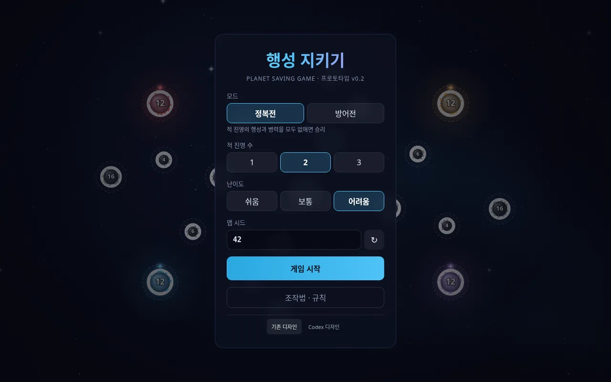 | 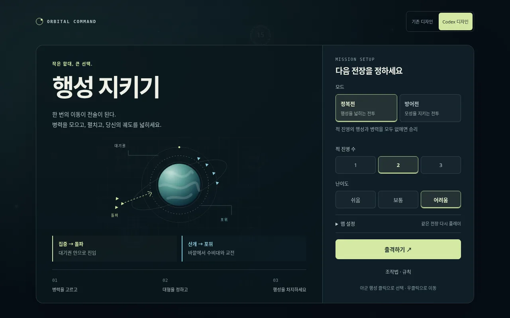 |

### PC 전장

| 기존 | Codex |
|---|---|
| 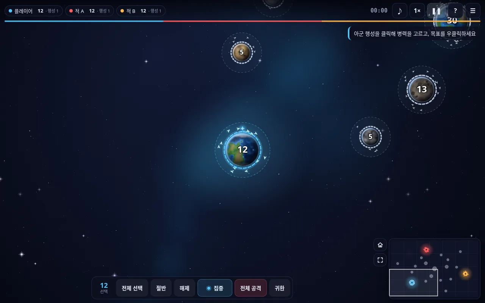 | 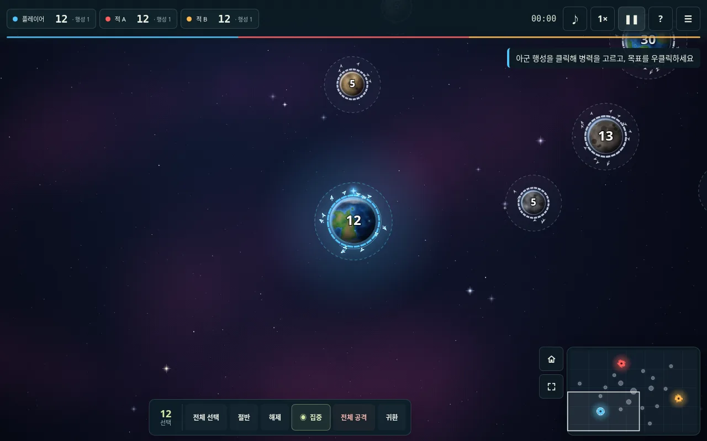 |

### 모바일 메뉴와 전장

| 기존 메뉴 | Codex 메뉴 | 기존 전장 | Codex 전장 |
|---|---|---|---|
| 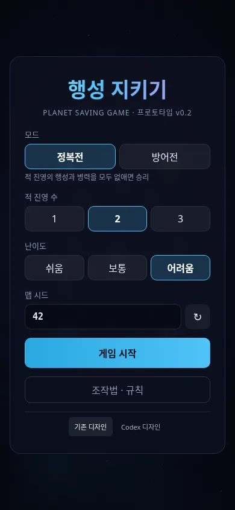 | 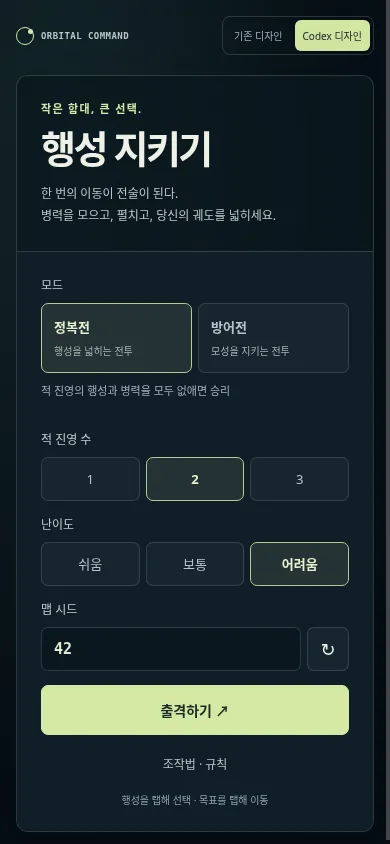 | 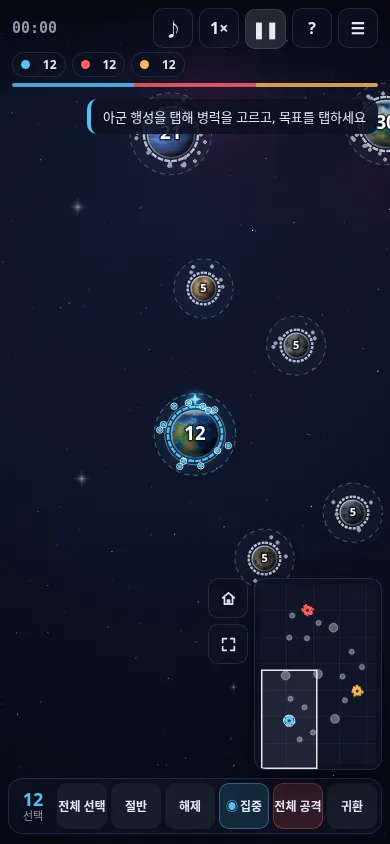 | 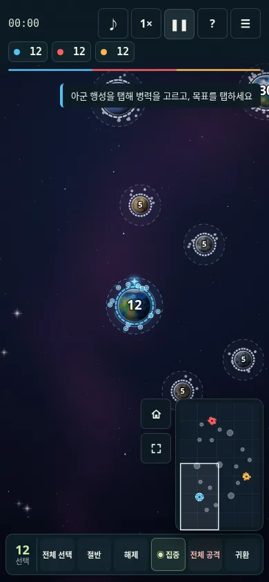 |

### 작은 화면과 도움말

| 320×568 출격 준비 | 568×320 가로 설정 | 390×844 터치 도움말 |
|---|---|---|
| 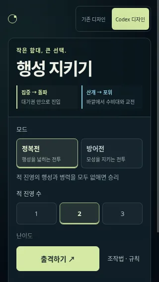 | 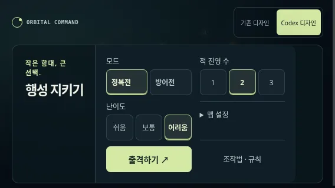 | 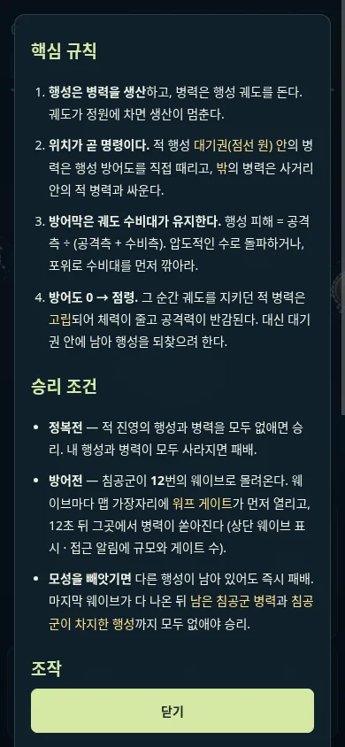 |

## 다시 검증하기

```bash
# 자체 개발 서버를 열어 검사하고 종료한다.
npm run test:browser

# 같은 검사와 함께 비교 화면 갱신
npm run test:browser -- --screenshots=docs/design
```

브라우저 검사는 두 디자인에서 1280×800, 768×1024, 390×844, 320×568, 844×390, 568×320 화면을 검사한다. 실제 마우스·터치·키보드 이벤트로 시작, 선택, 일시정지·재개, 다자전 패배·재시작, 방어전 도움말, 설정을 유지하는 디자인 전환을 확인한다. 대화창의 Tab·Shift+Tab·Escape·Enter 동작, Codex의 출격 버튼 노출·주요 터치 영역·맵 설정 펼치기·난이도 변경도 검사한다. 설치된 Chromium이 필요하며, 다른 실행 파일은 `CHROMIUM_PATH`로 지정한다.

이번 검증은 개발 서버와 **단일 HTML 결과물을 제공하는 정적 서버**에서 모두 통과했다. 이 클라우드 Chromium은 관리 정책으로 `file:` 탐색을 차단하므로, 파일을 직접 여는 경로는 확인하지 못했다.

다음 비교에서는 첫 출격까지 걸리는 시간, 돌파·포위 설명의 이해도, 모바일 오탭, 전투 중 주요 정보의 가독성을 관찰한다. 현재 화면 검증은 실사용자 조사나 실제 휴대폰 성능 측정을 대신하지 않는다.
